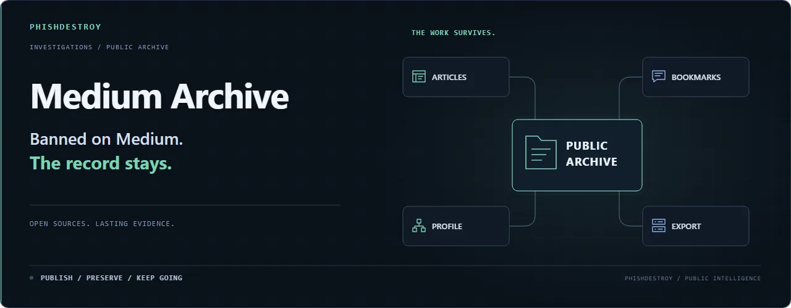

# 📖 Medium Archive — PhishDestroy

  <picture><source media="(max-width:600px) and (prefers-reduced-motion:reduce)" srcset="assets/archive-readme/hero-mobile-poster.webp" /><source media="(prefers-reduced-motion:reduce)" srcset="assets/archive-readme/hero-poster.webp" /><source media="(max-width:600px)" srcset="assets/archive-readme/hero-mobile.webp" /></picture>
  
<strong>Phishing exposés published on Medium. Banned. Preserved here.</strong>

  
  
  

## 📡 The work continues

**Reddit is back. Mastodon is live. Our main X account is still locked.**

We exposed NameSilo. Then our main X account, **@Phish_Destroy**, was locked. We've received **three appeal approvals** saying **“NO VIOLATION”** and promising restored access. **Three approvals. Still locked.**

<strong>More channels & public data</strong>

| Platform   | Link / dataset                                              |
|------------|----------------------------------------------------------|
| 🐤 Telegram  | [@destroy_phish](https://t.me/destroy_phish) |
| 🦖 Database  | [`list.json`](https://github.com/phishdestroy/destroylist/blob/main/list.json) |

  
  

## ❌ Account Terminated ⚰️

<strong>View screenshot · PhishDestroy Medium account before ban</strong>

 PhishDestroy Medium account before ban

For more than a year, we submitted **lists with tens of thousands of phishing reports**.  
Mostly **crypto airdrop scams with drainer scripts** that dominated search engines and took first positions.  

Our own articles strictly followed Medium’s rules:  
- 🔍 OSINT investigations  
- 🌐 Domain analysis and registrar evidence  
- ✅ No personal data, no violations  

We have nothing to hide — so here is an **almost full export of our account**, across all categories.  

Medium, instead of supporting this work, chose to keep **AI-generated scam spam** published from thousands of unverified accounts.  

## 📂 Archive Contents

| File / Folder   | Description                         |
|-----------------|-------------------------------------|
| [`index.html`](index.html)    | Landing page of the archive         |
| [`posts/`](posts/)        | Published articles                  |
| [`bookmarks/`](bookmarks/)    | Saved links and references          |
| [`claps/`](claps/)        | Acknowledged articles               |
| [`profile/`](profile/)      | Account profile data                |
| [`screen.png`](screen.png)    | Screenshot of suspended account     |
| [`image.png`](image.png)       | Repo banner image                   |

## 👶 Message to Scam Networks 💩

Banning accounts doesn’t stop us.  
Reports multiply. Data is preserved.  
Your scam domains keep getting blocked.  

That’s not a threat — **that’s a guarantee.**

## 👮 Legal Notice

- All data is public and OSINT-based  
- No personal/private information included  
- Published only for research, evidence, and digital preservation  

  

